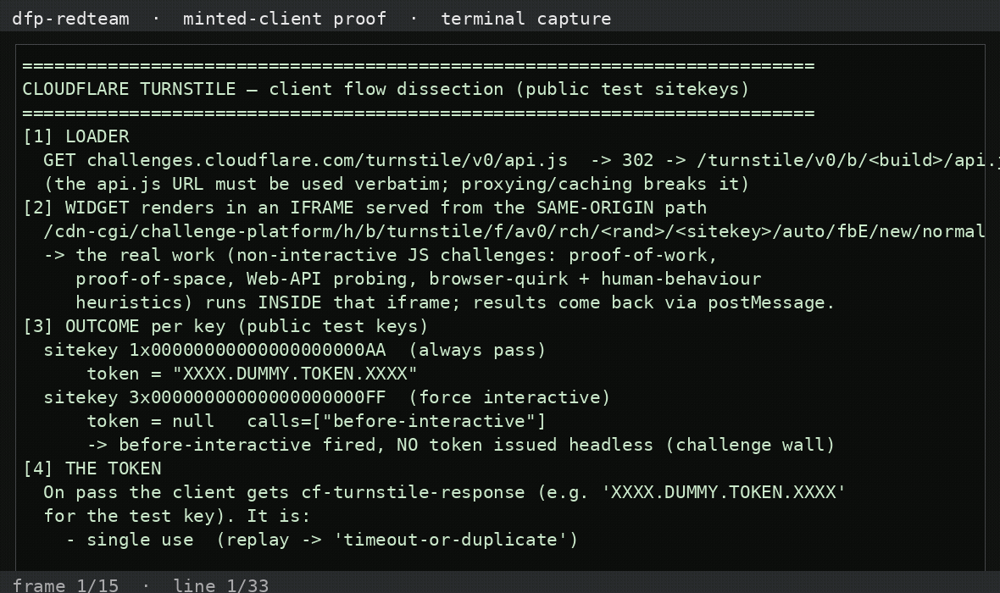

# dfp-redteam-turnstile — Cloudflare Turnstile

Authorized dissection of Cloudflare Turnstile's **client** using the public
test sitekeys from Cloudflare's own docs (`1x00000000000000000000AA` always-pass,
`3x00000000000000000000FF` force-interactive). No production bypass attempted.
Detail: [`TURNSTILE_BREAK_2026_11_02.md`](TURNSTILE_BREAK_2026_11_02.md).

---

## What we found

- **Loader**: `challenges.cloudflare.com/turnstile/v0/api.js` → 302 → versioned
  `/turnstile/v0/b/<build>/api.js` (must be used verbatim — no proxy/cache).
- **Widget** renders in an iframe on the **same-origin** path
  `/cdn-cgi/challenge-platform/h/b/turnstile/f/av0/rch/<rand>/<sitekey>/auto/…`.
  The real work — non-interactive **proof-of-work, proof-of-space, Web-API
  probing, browser-quirk + human-behaviour** challenges — runs inside that frame
  and reports back via `postMessage`.
- **Token** (`cf-turnstile-response`): issued only on pass (test key returns the
  literal `XXXX.DUMMY.TOKEN.XXXX`). It is **single-use, 300 s TTL, validated
  server-side** at `/turnstile/v0/siteverify` with the secret key. The secret
  never ships → the client **cannot mint or forge** a token.

## Status

- 🟢 Read flow: loader, challenge iframe, postMessage protocol, token issuance
- 🔴 Mint/forge token: **server-side, single-use, secret-gated** — not forgeable
  from the client
- ⚪ Bypass (out of scope here): a **patched real browser** solves it legitimately
  (public `Theyka/Turnstile-Solver` / patchright reads `[name=cf-turnstile-response]`)

## Recorded demo

<video src="assets/demo-turnstile.mp4" width="720" controls></video>

## Artifacts & scripts

- [`artifacts/cap-pass-result.json`](artifacts/cap-pass-result.json) — always-pass key → dummy token
- [`artifacts/cap-interactive-result.json`](artifacts/cap-interactive-result.json) — force-interactive → challenge withheld
- `scripts/turn-capture.mjs` — drive the real widget + capture the flow
- `scripts/demo-turnstile.py` — print the analysis

## Honest caveats

- Used **public test sitekeys only**; no production token was forged, replayed,
  or farmed, and no protected endpoint was called.
- Turnstile runs the **same Challenge Platform** as Cloudflare's WAF challenge /
  `cf_clearance` flow; we dissected the widget path, not an enterprise
  pre-clearance configuration.
- This is a **"good" design** in the good-vs-bad framing: no forgeable client
  proof — the client is a shuttle, the decision is server-side.

## Wire / tamper / mint (what can we actually do?)

- **See the wire?** No plaintext payload — the challenge runs inside Cloudflare's
  proprietary `/cdn-cgi/challenge-platform/…` frame; the only client-visible
  artefact is the opaque token. Nothing to read.
- **Tamper?** The token is an opaque server-checked value; there is no client
  field you can flip to influence the verdict.
- **Mint?** We called **Siteverify** with Cloudflare's **public test secret**:
  any token (even garbage) returns `success:true` with
  `metadata.result_with_testing_key:true` — the *test* key is permissive by
  design. **Production tokens are server-validated, single-use, 300 s TTL,
  secret-gated → not mintable** (`artifacts/siteverify-boundary.json`).
